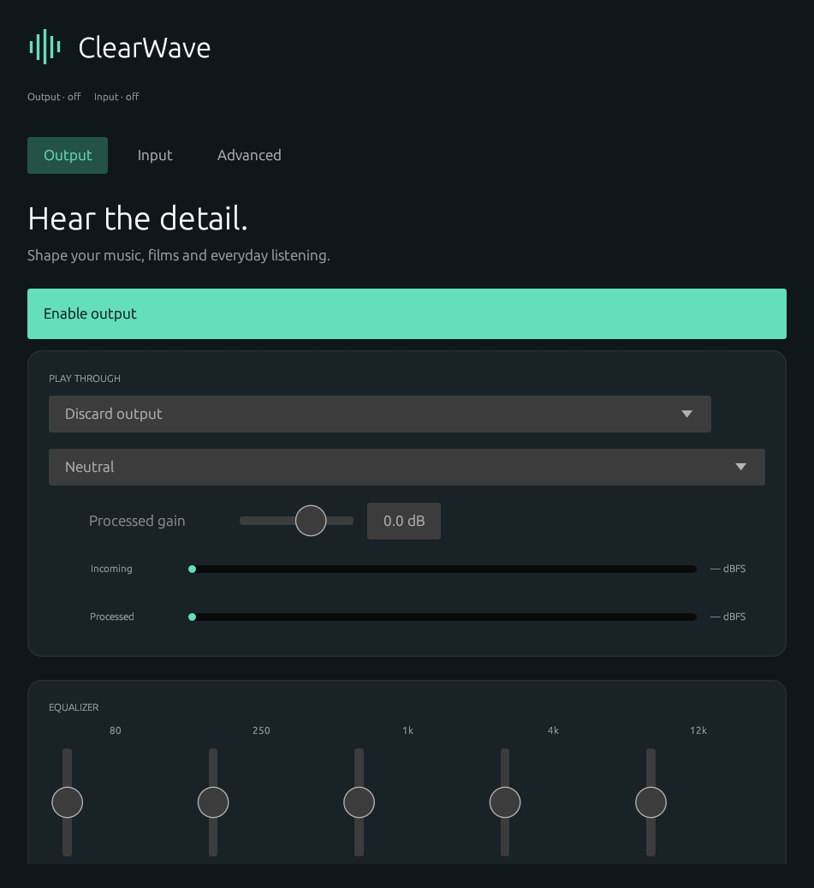

# ClearWave — Linux audio, made clearer

ClearWave processes playback and your microphone locally, with an original dark
interface with live Omarchy colors and a built-in theme menu. Audio stays in memory: no uploads or saved recordings.
Linux only, using PipeWire-Pulse or PulseAudio. Windows support has been removed.



Screenshot uses generated test endpoints; no real microphone was captured.

## Build and run

Use a current stable Rust toolchain (the dependency lockfile is committed), Python
3 for isolated integration tests, and PulseAudio client tools. On Arch the runtime
tools are in `libpulse`; on Debian/Ubuntu install `pulseaudio-utils`. A running
PipeWire-Pulse or PulseAudio desktop session is required. ALSA-only and JACK-only
sessions are not supported directly. GUI builds require the platform libraries
for eframe: on Debian/Ubuntu, `libxkbcommon-dev libwayland-dev libgl1-mesa-dev`.

Install stable Rust from [rustup.rs](https://rustup.rs/). On Debian/Ubuntu, also
install `build-essential pkg-config` and the GUI libraries listed above.

```sh
git clone https://github.com/monishPanjwani/ClearWave.git
cd ClearWave
cargo build --locked
cargo run --locked -- open
cargo run --locked -- doctor --json
cargo run --locked -- devices --json
./scripts/build.sh        # release binary + documentation/license bundle in dist/
./scripts/build.sh cli    # release CLI without desktop dependencies
```

No build command installs packages, enables services or changes audio defaults.
Start with low listening volume. The sample limiter prevents processed sample
overshoot; it cannot guarantee safe listening volume or undo hardware clipping.

## Output

1. Choose physical speakers/headphones, then a preset (Neutral, Music, Movies or
   Voice), and enable Output. It creates a stereo **ClearWave Output** sink.
2. Select that sink in your app's audio settings, or use **Advanced → Use processed
   output by default**. Existing application streams may need explicit selection
   in your system mixer or an app restart; ClearWave does not forcibly move them.
3. Adjust the five EQ bands, gain, Bass, Clarity and Stereo width while listening.
   Gain includes attenuation (-36 to +18 dB). Stereo width 0 is mono, 1 preserves
   the image, 2 widens side content. Bass/Clarity are broad peaking filters, not
   reconstructions of FxSound's effects. There is no reverb/ambience control.

Output processing is 48 kHz float stereo. The EQ centers are 80, 250, 1000, 4000
and 12000 Hz, fixed Q=1, with ±12 dB gain. Optional compression and low cut are in
Advanced. Compression reduces peaks above its threshold; increase processed gain
carefully for louder quiet material. Ratio 1:1 disables compression. A linked
sample-peak limiter is always active (0.98 ceiling); it preserves channel balance
but is not a true-peak mastering limiter. Ordinary app processing and hardware
volume still affect the final sound.

## Input

Choose a microphone and a preset (Natural, Clear Speech, Warm Voice or Noisy Room),
then enable Input explicitly. Choose **Clearwave Microphone** in your call app.
RNNoise cleanup, a speech-confidence gate, five-band EQ, low cut, processed gain,
compression and limiting run locally. Input/output meters use dBFS and smooth
visual decay. The clipping count refers to original digital microphone samples;
lower the microphone's hardware volume in your system mixer if it clips.
Processed gain is separate and cannot repair clipping that already happened.

Monitoring is off by default. In Advanced, explicitly choose headphones before
turning on microphone listening; speakers can cause feedback. Changing monitoring
or device selection restarts only the affected pipeline. Processing parameters
update live, with smoothed scalar controls and 20 ms crossfades between filter
banks. Rapid EQ changes coalesce while a transition finishes. RNNoise bypass
crossfades too. Latency includes 10 ms frame processing, RNNoise/gate delay,
server buffering and hardware latency; no measured end-to-end latency is claimed.

Both pages expose basic EQ and presets. Edits mark the preset Custom. Reset to
neutral disables effects and noise cleanup while retaining the safety limiter.
Save/delete up to 32 original custom input/output presets from Advanced.

## Background operation and settings

The GUI is a control surface for a separately running engine. Opening it starts
an **idle** per-user engine and attaches to an existing instance when available.
Opening the window, starting the daemon, or loading settings never starts capture.
Output and Input start and stop independently. Closing the window normally stops
both pipelines and the daemon. Turn on **Keep audio running when this window
closes** to preserve them; reopening attaches without restarting audio. Explicit
**Quit / stop background engine** stops both and cleans owned resources even when
background operation is enabled. Window close waits for the control handshake;
unresponsive server operations have bounded timeouts, so cleanup can take several
seconds (the IPC client deadline is 90 seconds). SIGINT/SIGTERM also request cleanup. SIGKILL/power loss cannot guarantee
cleanup of server modules/defaults; use your audio mixer to choose physical devices
and unload only the `clearwave_…` modules you identify after a forced termination.

Settings are versioned JSON at `$XDG_CONFIG_HOME/clearwave/settings.json` (or
`~/.config/clearwave/settings.json`). Changes apply live and save atomically after
500 ms without further edits, and before normal daemon shutdown. Invalid, oversized,
unknown-version or malformed settings produce a visible warning and safe defaults;
the original file is retained until an explicit valid configuration edit replaces
it. Running state is never persisted. A failed save is visible in diagnostics.

The engine uses a mode-0700 per-user runtime directory and mode-0600 Unix socket,
with a held file lock to enforce one engine. It exposes no network port. IPC is
bounded at 64 KiB with message deadlines. Runtime path is
`$XDG_RUNTIME_DIR/clearwave/engine.sock`, falling back to `/tmp/clearwave-UID/`.
The GUI performs server operations on a control thread, updates meters at a limited
cadence while active and avoids continual idle redraws. Stop/failure status remains
visible on every page. Use one control window at a time to avoid overwriting edits
from multiple windows.

Defaults restore only if they still point at ClearWave when processing stops;
changes made later by you or another app are preserved. Microphone and playback
routes are checked by live process IDs. Disconnects, moved streams or server
failures stop the affected pipeline and report an error; reconnect, refresh devices
and enable again. There is no automatic capture restart onto an unintended mic.
Playback can suspend while idle without being treated as a stall.

## Automation CLI

Existing microphone automation contracts remain supported:

```sh
clearwave doctor --json
clearwave devices --json
clearwave run --input SOURCE_ID --boost-db=-6 --no-denoise --json
clearwave run --input SOURCE_ID --monitor --output HEADPHONE_SINK --make-default
clearwave volume input SOURCE_ID 75 --json
clearwave volume output SINK_ID 60 --json
clearwave default output SINK_ID --json
```

`run` is a foreground microphone session; Ctrl+C/SIGTERM stops and restores an
owned default. `--make-default` is temporary; the separate `default` command is an
explicit persistent system choice. `volume` changes hardware/server volume (0–150%),
not processed gain. `--json` reports structured errors and nonzero exit status.

Background engine commands (start `clearwave daemon` first, or open the GUI):

```sh
clearwave daemon
clearwave engine status --json
clearwave engine configure my-settings.json --json
clearwave engine start                 # output, using configured destination
clearwave engine start --input         # explicit microphone capture
clearwave engine stop --input
clearwave engine stop                  # output
clearwave engine shutdown
```

`configure` takes the same versioned JSON schema as the saved settings. Use the GUI
to create a valid example, then copy its settings file. Applying settings does not
start stopped pipelines. Device changes restart only an already active pipeline.
The socket protocol is newline-delimited JSON matching `src/engine.rs` Request;
clients should use bounded connection/read/write timeouts. Separate foreground
`run` sessions have independent ownership; the singleton applies to the daemon.

## Optional desktop and login integration

`./scripts/install-desktop.sh` builds, installs to
`${XDG_DATA_HOME:-$HOME/.local/share}/clearwave/clearwave`, and adds a launcher.
Run it only when you want that persistent installation. `./scripts/build-appimage.sh`
builds an x86_64 AppImage, downloading appimagetool if `APPIMAGETOOL` is not supplied.
The AppImage still needs the host audio client tools and a working desktop GL/audio
session. AppImage packaging is separate from validation of the Rust release build.

`packaging/clearwave.service` is an **uninstalled** user-service template. To opt in,
copy it to `~/.config/systemd/user/`, adjust ExecStart for your install path, then
run `systemctl --user daemon-reload` and
`systemctl --user enable --now clearwave.service`. It starts only the idle daemon,
not microphone capture. Disable with
`systemctl --user disable --now clearwave.service`. Do not run a service and a second
manual daemon intentionally; the singleton lock rejects the second instance.

## Development and verification

```sh
cargo fmt --check
cargo clippy --locked --all-targets -- -D warnings
cargo test --locked
cargo test --locked --no-default-features
cargo build --release --locked
bash -n scripts/build.sh scripts/build-appimage.sh scripts/install-desktop.sh
```

`src/enhance.rs` implements stereo EQ/dynamics; `src/dsp.rs` retains RNNoise/gating;
`src/settings.rs` owns versioning/validation/persistence; `src/platform/linux.rs`
owns PulseAudio children/modules/defaults; `src/engine.rs` owns IPC/session lifetime;
`src/ui.rs` is the asynchronous desktop control surface. `tests/` contains CLI and
process-isolated mock audio-server lifecycle tests. Tests generate audio/silence
and never access personal microphones or change real audio defaults. No credentials
or local `.env` files are needed. See `docs/validation.md` for verified behavior and
remaining manual checks.

UI framebuffer captures can be generated explicitly with
`CLEARWAVE_CAPTURE_UI=/absolute/output/directory clearwave open`; this captures only
the app's three pages and closes it, never the desktop or microphone. Use an isolated
runtime/config and the test fixture server for reproducible captures.

The original ClearWave implementation is MIT; dependency licenses still apply
when sharing binaries with friends. `scripts/build.sh` collects dependency notices
under `dist/licenses/`; review missing-notice warnings before redistribution. The
FxSound research and standard DSP equation references, with explicit differences,
are documented in [THIRD_PARTY_NOTICES.md](THIRD_PARTY_NOTICES.md). No FxSound code or
assets are distributed, and no FxSound-identical sound or universally optimal EQ
is claimed.

## Appearance

Use the **Theme** menu on any page to select Follow Omarchy or an offline bundled
palette: Tokyo Night, Catppuccin Mocha, Catppuccin Latte, Nord, Rosé Pine Dawn,
Gruvbox, Everforest, Flexoki Light, or ClearWave Classic. No Omarchy installation
is needed for the bundled palettes. Selection affects only this application.

On first launch ClearWave follows a valid active Omarchy palette when available;
otherwise it uses Classic. Manual selection overrides following and is saved.
Following reads `$XDG_STATE_HOME/omarchy/current/theme/colors.toml` (default
`~/.local/state/...`), falling back to the older `$XDG_CONFIG_HOME/omarchy/current/theme/colors.toml`
location. The GUI checks for replacement every two seconds while following; it
keeps the last valid palette during missing/invalid updates and shows a fallback
notice. Closing the GUI stops theme checks while background audio continues.
Palette changes crossfade over 250 ms and never restart processing or capture.
